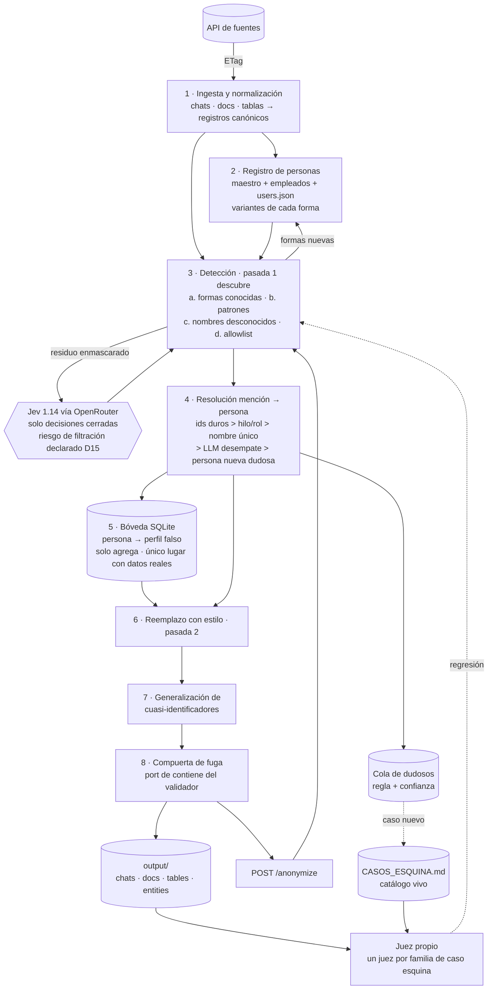

# Diseño: Vende los datos sin vender a la gente

Versión 2 · 2026-10-31 · Reto Frontier, Kipu Pay

## 1. El problema en una frase

Entregar el mismo corpus de soporte (chats, documentos y tablas) **con cada persona real sustituida por una persona
falsa coherente**, la misma en todas las fuentes y estable cuando el corpus crece, sin tocar el contenido de negocio.

El jurado es un programa que puntúa fuga (45), utilidad (35) y consistencia (20), y además prueba en vivo con
registros que no hemos visto.

## 2. Qué tiene que resolver el sistema

| Requisito                                    | Origen          | Consecuencia de diseño                                     |
| -------------------------------------------- | --------------- | ---------------------------------------------------------- |
| Ningún dato real en ninguna parte de la salida (texto, metadata, nombres de archivo, claves) | Fuga 35 + 10 | Barrido final con la misma normalización que el jurado |
| Mismo seudónimo para la misma persona en todas las fuentes | Consistencia 8 | La unidad es la **persona**, no la cadena de texto |
| Dos personas con el mismo nombre reciben seudónimos distintos | Homónimos 5 | Identidad por evidencia (ids, contexto), nunca solo por el nombre |
| El seudónimo conserva categoría y formato      | Utilidad 8      | Perfil sintético completo por persona                      |
| El texto no personal no cambia                 | Utilidad 10     | Reemplazo literal de fragmentos, sin reescribir            |
| Bancos, marcas, lugares y figuras públicas se quedan | Utilidad 9 | Allowlist con reglas de contexto                         |
| Llaves, conteos por persona y quién habla con quién se mantienen | Utilidad 8 | Los ids internos no se tocan; el autor se seudonimiza como cualquier mención |
| "Reporta a" entre empleados                    | Consistencia 4  | `reporta_a` → seudónimo corto del jefe                     |
| `entities.json` honesto                        | Consistencia 3  | Se declaran todas las formas reales encontradas            |
| Las fuentes crecen sin aviso; los seudónimos viejos no cambian | Multiplica consistencia | Bóveda persistente de solo agregar |
| `/run` < 2 h; `/anonymize` < 60 s por lote de 50 | Contrato       | Reglas primero y LLM solo para el residuo, con caché      |

## 3. Supuestos

1. **El maestro es la verdad de identidad.** `clientes.csv` (149) y `empleados.xml` (36) anclan a las personas.
   `users.json` se une al maestro por `users.name` = parte local del correo (148 de 149) y por el correo
   `@kipupay.co` para empleados.
2. **Los ids internos no son PII.** `CL-`, `TX-`, `PQR-`, `KP-`, `INC-` y `S-` se conservan: son lo que une las
   tablas, y la salida ideal de la muestra los deja intactos.
3. **Los dominios de correo públicos y `kipupay.co` no son PII.** El dominio del correo falso se toma de un pool
   público; el corporativo se mantiene.
4. **El bot Kipi y la marca Kipu Pay no son personas.**
5. **Las fechas de negocio, los montos, las ciudades y las fechas de vinculación se conservan.** La muestra lo hace así.
6. **El reemplazo es literal.** La salida ideal deja "entré con ustedes en hace unos años": se cambia el fragmento y
   no se arregla la gramática.
7. **La salida ideal es la referencia de estilo.** Las reglas de formato (seudónimo corto o largo, slug, correo
   `inicial+apellido`, ocupación → sector, barrio → otro de la misma ciudad) se copian de `sample/expected_output`.

## 4. Casos difíciles (con nombre propio)

| Caso                                                     | Ejemplo del corpus                                            | Cómo se resuelve                                         |
| -------------------------------------------------------- | ------------------------------------------------------------- | -------------------------------------------------------- |
| Homónimos cliente–cliente                                | 2 Camila Arango, 2 Daniela Ordóñez, 2 Juliana Mejía, 2 Mateo Henao | Evidencia en otra fuente: radicado PQR, fecha + monto en transacciones, cédula, placa, adjunto |
| Agente que se llama como un cliente, en el mismo hilo     | Agente Andrés Gómez y cliente Andrés Gómez Giraldo            | Primero uid y rol del autor; luego "soy X" o el handoff del bot |
| MAYÚSCULAS sin tildes                                     | `BRAYAN GOMEZ VARGAS` en transacciones                        | Búsqueda en espacio normalizado (sin tildes, minúsculas) |
| Correo deletreado                                         | "juan punto perez arroba gmail punto com"                     | Detector propio; el reemplazo se emite en el mismo estilo |
| PII fuera del texto visible                               | Author/Keywords del PDF, comentarios HTML, `display:none`, `mailto:`, front matter, rutas de imagen, URLs de Loom, `files[].name`, `filename` | La ingesta lleva todo a campos de texto que se anonimizan igual que el cuerpo |
| PII disfrazada                                            | Cédula "de ejemplo" del manual (es real), celular del CEO en el memo a inversionistas | Las formas conocidas del registro se barren en todo el texto, sin depender de palabras clave |
| Cuasi-identificador sin nombre                            | "contadora, Barranquilla, desde 2024" (CL-50124)              | Generalización en el texto **y** en la fila del maestro |
| Apellido que es lugar o marca                             | "PSE de Luis Santander desde Santander", "Mariana Carulla … compra en Carulla" | Persona si va precedido de un nombre de pila o coincide con una forma conocida; si no, se conserva |
| Nombre común que es palabra                               | "Claro" (39 veces) frente a la empleada Clara                 | El nombre de pila suelto solo se reemplaza si el hilo o documento lo ata a una persona |
| Respuestas de solo dígitos                                | "##########" (10 dígitos) después de "¿me confirmas tu cédula?"            | Se clasifican con la pregunta anterior del hilo          |
| Usuario borrado                                           | U07HF5JVK sin `real_name`                                     | Se identifica por la cédula que da en el texto (CL-58402) |
| Persona fuera del maestro                                 | CL-55481 (cliente sin fila): PQR y usuario de chat            | Entidad creada a partir de la evidencia, con llave `CL-55481` |
| Terceros sin fila                                         | Cuatro nombres que solo aparecen en chats y notas              | Entidad nueva con llave de contexto, persistida         |
| Documentos en inglés                                      | Security report, contrato Veloz, memo a inversionistas        | Mismos detectores más los marcadores "Prepared by", "ID No."; el LLM cubre el residuo |

## 5. Qué dejamos fuera

| Fuera de alcance                              | Por qué                                                          |
| --------------------------------------------- | ---------------------------------------------------------------- |
| Reescribir o "pulir" el texto con un LLM      | Pierde parecido con la salida ideal y puede inventar datos       |
| Arreglar la gramática tras generalizar        | La salida ideal no lo hace                                       |
| OCR de imágenes                               | No hay imágenes con texto en el corpus                           |
| Desplazar fechas o montos de negocio          | Destruye utilidad; no son PII por sí solos                       |
| k-anonimato formal con umbral                 | Con 149 filas, cada combinación es única (k=1); se generaliza siempre, como en la muestra |
| Traducir los documentos en inglés             | No lo pide el reto                                               |

## 6. Arquitectura

**Un solo núcleo, dos entradas.** `/run` y `/anonymize` llaman la misma función `Anonymize(records)`. La ingesta
solo traduce los formatos crudos al esquema normalizado, que es exactamente el que recibe `/anonymize`.

### 6.1 Componentes

**1. Ingesta.** Convierte cada fuente al esquema de `output/`.
- Chats: `author` = nombre corto del usuario (nombre(s) + 1er apellido), `thread_id` = `canal:thread_ts` (o el `ts`
  propio si es la raíz), `attachments` = `files[].name`.
- Documentos: MD tal cual; HTML → markdown conservando comentarios y bloques ocultos; PDF → markdown con
  encabezados por tamaño de letra y tablas por celdas. La metadata conserva las mismas claves que la entrada.
- Tablas: `clientes.csv` se decodifica desde Latin-1; los atributos XML (`radicado`, `cedula`, `agente`) son columnas;
  todo como texto.

**2. Registro de personas.** Una entrada por persona con llave estable (`p_cl_<num>`, `p_kp_<num>`,
`p_t_<hash>`), género, rol (cliente o empleado) y **todas sus variantes**:
nombre completo, corto, de pila, MAYÚSCULAS sin tildes, slug (`manuela_castano`), usuario (`mcastano`), correo,
correo deletreado, cédula con y sin puntos, `CC<num>`, celular pegado / `+57 3xx xxx xxxx` / con guiones,
dirección, fecha de nacimiento en ISO, en palabras y en formato US, placa con y sin guion, pasaporte.

**3. Detección.** Toda la búsqueda corre sobre un **espacio normalizado idéntico al del jurado** (NFKC, confusables,
sin tildes, minúsculas, dígitos sin separadores) con un mapa de offsets para volver al texto original.
- a. **Formas conocidas** (Aho-Corasick sobre las variantes del registro): la capa principal.
- b. **Patrones**: cédula (con contexto, para no atrapar montos ni el NIT), celular, correo, correo deletreado,
  placa, pasaporte, cuenta, dirección, fechas, URLs con usuario, tokens en nombres de archivo.
- c. **Nombres desconocidos**: diccionario de nombres y apellidos colombianos más mayúscula inicial. Lo que queda
  dudoso lo **proponen las reglas como candidato** (cuatro generadores, D30) y **Jev 1.14** lo clasifica con una pregunta cerrada (persona,
  organización, lugar, marca, otro) y su confianza; nunca genera ni reescribe texto (D13).
- d. **Allowlist** de entidades a conservar (≈30 vistas), con la regla de apellido-lugar, más reglas genéricas
  (sufijos `S.A.S.`, "Banco …", mayúscula sin nombre de pila delante) para lo que llegue con el crecimiento.
- **Dos pasadas (D14).** La pasada 1 recorre todo el corpus y devuelve al registro las formas descubiertas en el texto
  (cédula del usuario borrado, terceros, apodos). La pasada 2 reemplaza con el registro ya completo.
- **Lo que ve el LLM (D15).** Antes de enviar, toda forma conocida se enmascara (`[PERSONA_1]`); viaja solo una
  ventana de contexto alrededor del residuo, con proveedores sin retención en OpenRouter y caché por hash. El residuo
  son, por definición, datos reales que nadie más detectó: **puede filtrarse al proveedor del LLM** y así se declara.

**4. Resolución.** Para cada mención, la evidencia se ordena por fuerza:
1. Identificador duro: cédula, correo, celular, `CL-`, `PQR-` → `pqrs.xml`, placa, fecha + monto → `transacciones`.
2. Contexto: autor del mensaje (uid), participantes del hilo, rol ("soy X", handoff del bot), cliente del hilo.
3. Nombre: solo si hay un único candidato compatible.
4. LLM: solo para desempatar entre candidatos, con el contexto del registro.
Si nada vincula, se crea una persona nueva con llave de contexto, que se persiste.
Los pasos 1–3 son consultas a índices construidos en la fase de registro, sobre entradas ordenadas por id: son
deterministas. Un empate nunca se resuelve escogiendo uno cualquiera: va al LLM, y si el LLM no está (timeout de
`/anonymize`), se crea una persona nueva con llave de contexto marcada como dudosa (D19). Cada mención guarda la regla
que la resolvió y su confianza; las de baja confianza van a la cola de dudosos en SQLite (D20), que alimenta el
catálogo de casos esquina.

**5. Fábrica de seudónimos y bóveda.**
- Nombres de un catálogo embebido de nombres de pila colombianos por género y apellidos con tildes (D18). El género
  sale del nombre de pila real en ese catálogo; el respaldo es la ocupación flexionada ("fotógrafa") o el contexto
  ("la clienta"). Se conserva la estructura: dos nombres y dos apellidos producen dos y dos.
- Perfil completo por persona: nombre del mismo género (1 o 2 nombres de pila + 2 apellidos), correo
  `inicial+apellido@<dominio público>` o `nombre.apellido@kipupay.co`, cédula de la misma longitud y prefijo,
  celular 3xx, dirección colombiana, fecha de nacimiento cercana, placa, pasaporte, barrio de la misma ciudad.
- Semilla `HMAC(secreto, llave estable)`: el perfil es función de la llave y no del orden; el secreto evita que una
  llave `p_t_` derivada de un nombre real se revierta por fuerza bruta.
- Restricciones: seudónimo único y **sin coincidencias con ninguna forma real** del registro (tampoco números de
  otra persona).
- La bóveda es SQLite en el volumen de Railway y **solo agrega**. Con el registro, es el único lugar con datos
  reales: se respalda tras cada corrida a disco local fuera de git, nunca al repo.

**6. Reemplazo con estilo.** Los fragmentos se reemplazan de derecha a izquierda con la variante equivalente del
perfil, respetando mayúsculas, tildes, puntos, separadores, "arroba/punto" y slug. Recorre todos los strings del
registro: texto, nombres de archivo, metadata, front matter, comentarios.

**7. Cuasi-identificadores.**
- Tablas: en `clientes`, ocupación → sector (13 sectores) y barrio → otro barrio de la misma ciudad.
  `empleados.cargo` se conserva: es el rol del empleado dentro de la organización, no un cuasi-identificador suelto.
- Texto: cuando ocupación, barrio y año aparecen ligados a una persona → ocupación a sector, barrio a ciudad,
  año de la relación a "hace unos años", este último solo con ancla de relación ("llevo con ustedes desde",
  "cliente desde"). Cubre la plantilla "soy X, vivo en Y, desde Z" y las descripciones de los agentes.

**8. Compuerta de fuga.** Port de `contiene()` de `validar.mjs`. Barre todas las formas originales del registro sobre
toda la salida (incluidas claves de objetos) y busca también hashes sin sal (MD5/SHA-1/SHA-256) de las formas. Si
encuentra algo, lo reemplaza y lo registra. La corrida termina con 0 fugas conocidas o falla ruidosamente en el log.

### 6.2 Servicio

| Endpoint             | Implementación                                                                    |
| -------------------- | --------------------------------------------------------------------------------- |
| `GET /v1/health`     | `{status, team, version, models: ["typesafe/jev-1.14 vía OpenRouter"]}`                           |
| `POST /v1/run`       | Crea un job en SQLite y lo corre en una goroutine; idempotente si ya hay uno corriendo |
| `GET /v1/run/{id}`   | Estado, conteos y costo (tokens de entrada y salida, segundos)                    |
| `GET /v1/output/*`   | Sirve los archivos de la última corrida terminada desde el volumen                |
| `POST /v1/anonymize` | Mismo núcleo, carga el registro y la bóveda; persiste personas nuevas; timeout interno de 45 s con respaldo sin LLM |
| `GET /v1/entities`   | `entities.json` de la última corrida                                               |

### 6.3 Stack

- **Go** (`net/http` con el `ServeMux` de Go ≥1.22: método y comodines en la ruta, sin router externo), **SQLite** con `modernc.org/sqlite` (sin cgo, imagen simple).
- **Modelo:** **Jev 1.14** (`typesafe/jev-1.14`) vía **OpenRouter** (`OPENROUTER_API_KEY`), endpoint
  `POST /api/alpha/decisions` con `state` y `questions` (`choice`, `noul`, `score`), llamado con un cliente HTTP propio.
  Varias preguntas por llamada, respuestas con `confidence` y `probabilities`. Modelo configurable por `LLM_MODEL`;
  caché por hash de entrada en SQLite. Medido con datos inventados: 0,23–0,5 s por llamada, ~US$0,00002 por
  decisión, proveedor único TypeSafe, misma respuesta en llamadas repetidas, acepta `provider.data_collection: deny`.
- **PDF:** las librerías de Go pierden espacios en celdas partidas. Decisión: un ayudante en Python con pdfplumber
  invocado como subproceso solo para extraer texto y metadata (ver D7).
- **Railway** con Dockerfile y volumen montado en `/data` (bóveda, caché LLM, output). Configuración probada en la
  hackathon anterior: una réplica, Serverless apagado, reinicio `ON_FAILURE`, `PORT=8080`, healthcheck en
  `/v1/health` sin autenticación.

### 6.4 Reuso de la hackathon anterior (`../10102026`, 97/100)

Detalle en `analisis/05_reuso_10102026.md`.
- Arranque y apagado limpio (`cmd/replacement/main.go`), con `WriteTimeout` subido: 10 s cortaría `/anonymize`.
- `Open()` de SQLite con migraciones por `user_version` y sus pruebas de reapertura; prueba de proceso con SIGKILL.
- **Captura de lo que manda el evaluador** (`internal/capture`): guardar cada lote que llega a `/anonymize` y cada
  `/run`, con el token redactado y sin escribir PII en stdout. Allá convirtió el 97/100 en tres casos concretos que
  se corrigieron; aquí convierte las pruebas en vivo ocultas en casos de regresión locales.
- Lecciones: todo estado en SQLite, nunca solo en memoria; timeout en cada paso; secretos redactados en logs;
  ningún test en verde sin comparar contra un esperado.

## 7. Decisiones y alternativas descartadas

| #  | Decisión                                                  | Alternativa descartada                          | Por qué                                                                                       |
| -- | --------------------------------------------------------- | ----------------------------------------------- | --------------------------------------------------------------------------------------------- |
| D1 | Reglas y registro primero; LLM solo para el residuo       | NER con LLM sobre todo el corpus                | ~435 mil tokens de costo, no determinista, riesgo de reescritura; por reglas ya se llega a ~88 |
| D2 | La unidad de seudonimización es la persona                | Mapear cadena → cadena                          | Una cadena no distingue homónimos y fusiona personas (70 puntos, según el enunciado)          |
| D3 | Perfil falso completo y coherente                         | Seudónimo independiente por campo               | Un correo que no corresponde al nombre aleja de la salida ideal y rompe la coherencia        |
| D4 | Bóveda persistente + semilla determinista                 | Solo HMAC determinista                          | Resolver colisiones depende del orden; con fuentes nuevas podría cambiar a una persona vieja  |
| D5 | Búsqueda en el espacio normalizado del jurado             | Regex sobre texto crudo                         | Se escapan MAYÚSCULAS sin tildes, confusables y dígitos con separadores                       |
| D6 | Reemplazo literal de fragmentos                           | Redactar con `[REDACTED]` o reescribir con LLM  | Redactar da 56 puntos; reescribir pierde parecido y puede borrar datos de negocio             |
| D7 | Go para el servicio + pdfplumber como subproceso          | Todo en Go (ledongthuc/pdf, pdfcpu) / todo en Python | Go es el stack fuerte del equipo; pdfplumber fue la única librería que extrajo bien tablas y celdas partidas en el análisis |
| D8 | Un solo núcleo para `/run` y `/anonymize`                 | Dos caminos separados                           | Garantiza el mismo seudónimo en `output/` y en vivo                                           |
| D9 | Cuasi-identificadores generalizados: en `clientes`, ocupación → sector y barrio → otro barrio de la misma ciudad; en el texto ligado a una persona, barrio → ciudad y año de la relación → "hace unos años", este último solo con ancla de relación («llevo con ustedes desde»). `empleados.cargo` se conserva: es el rol del empleado en la organización | Solo donde k < umbral | k=1 en las 149 filas de `clientes`; la salida ideal generaliza todo; el test evalúa la unión de fuentes |
| D10| Homónimos se desempatan con evidencia de otra fuente      | Por ciudad o cargo junto al nombre              | El enunciado dice que no aparecen; los 8 pares tienen desempate en PQR, transacciones o adjuntos |
| D11| Compuerta de fuga obligatoria al final                    | Confiar en la detección                         | Un falso negativo es fuga en cada registro de la persona; el barrido es barato               |
| D12| SQLite en volumen                                          | Postgres gestionado / archivos JSON             | Un solo proceso, sin red extra; JSON no da transacciones si `/anonymize` y `/run` coinciden |
| D13| Jev 1.14 vía OpenRouter (endpoint de decisiones) para todo lo que el pipeline delega: clasificar candidatos, desempatar, género. Confianza < 0,6 → dudoso o indeterminado | Claude Haiku 5.5 / `typesafe/jev-router` | Todas las preguntas son cerradas; Jev responde en 0,2–0,5 s con confianza calibrada y a ~1/50 del costo. `jev-router` reparte cada llamada a otro modelo y proveedor (2–4 s, costo ×30, más exposición). Haiku solo vuelve si un caso exige extraer texto libre que las reglas no propongan |
| D14| Dos pasadas: descubrir y luego reemplazar                 | Una sola pasada                                 | Una forma descubierta en el registro 900 ya se habría escapado en el 12                       |
| D15| Aceptar que el residuo llega al LLM, con enmascarado previo, ventana mínima, proveedor sin retención y caché | Sin LLM / modelo local | Sin LLM se pierden terceros y desempates; un modelo local no cabe en Railway ni en 60 s. **Riesgo declarado:** los datos reales que solo el LLM detecta o desempata salen hacia OpenRouter y su proveedor |
| D16| Catálogo vivo de casos esquina con juez asignado          | Set dorado plano y fijo                         | Cada caso descubierto se vuelve regresión; mide por mecanismo, como los tests ocultos          |
| D17| Juez propio con un juez especializado por familia         | Solo `validar.mjs` y los 13 tests de la muestra | El validador mide forma, no puntos; tres corridas oficiales no alcanzan para iterar            |
| D18| Catálogo embebido de nombres colombianos por género       | Faker o nombres al azar                         | Conserva género, región y estructura; permite excluir toda forma real del corpus              |
| D19| Empate sin LLM → persona nueva dudosa                     | Escoger el candidato más probable               | Fusionar a dos personas rompe homónimos y estructura; separar se corrige luego sin fuga        |
| D20| Regla y confianza por mención; cola de dudosos en SQLite  | Revisar logs                                    | Los logs no llevan PII; la cola se convierte en casos del catálogo                             |
| D21| Corrida 1 con corte mínimo: reglas + LLM + cuasi-identificadores en texto y maestro, juez base. La generalización corre siempre dentro del núcleo, sin interruptor | Esperar el diseño completo / apagar el cuasi en texto en la corrida 1 | La corrida 1 vale el 30 %; al llegar la ola 3 el cuasi ya estaba validado (muestra 13/13, `sample_08` incluido, validador OK en muestra y corpus) y dejarlo apagado habría publicado texto que la corrida 2 cambia |
| D22| Resolución consulta primero la bóveda; la llave `p_t_` se emite una vez (`HMAC(secreto, nombre normalizado + ancla)`) y se guarda | Recalcular la llave desde el contexto | El ancla solo sirve para emitir; recalcular cambia la llave cuando el corpus crece |
| D23| Tercero que reaparece: mismo nombre completo sin evidencia en contra = misma persona; evidencia dura distinta = otra; nombre suelto solo dentro del mismo hilo o doc | Unir siempre por nombre / nunca unir | Equilibra consistencia y homónimos con la evidencia disponible |
| D24| Personas de `/anonymize` en tabla aparte: reservan seudónimo, no entran al registro de `/run` ni a `entities.json` | Persistirlas en el registro | Sin registros en `output/` rompen el validador y pueden pegarse a personas reales nuevas |
| D25| Compuerta: forma con un dueño → su perfil y se agrega a `records`; ambigua → llave menor y dudosa; no barre nombres de pila sueltos | Reemplazo genérico | Una fuga cuesta más que un seudónimo equivocado; el validador también exime nombres sueltos |
| D26| El LLM desempata con la mención enmascarada y fichas abstractas de candidatos (ids, ciudad, PQR, tx), respuesta cerrada `A`/`B`/`ninguna` | Mandar nombres reales / sin LLM en resolución | Los homónimos comparten nombre: lo que desempata es la evidencia, y así no viaja el nombre |
| D27| Preguntas semánticas al modelo: solo `genero` (M/F/indeterminado → unisex) y `origen_del_nombre` | Etnia y edad | Ningún test las pide; inferir etnia es sensible y poco confiable; la edad sale de la fecha real |
| D28| `/anonymize`: una llamada al modelo **por mención**, con solo su propio `state` (varias preguntas juntas solo si comparten `state`), en paralelo con tope de 16; timeout 40 s, respaldo determinista, decisiones guardadas en caché y bóveda | Una sola llamada por lote con `state` compartido | Medido: el `state` de un registro sesga las respuestas sobre otro (mismo nombre, M 0,38 frente a indeterminado 0,66). A 0,4 s por llamada, 50 registros caben en 40 s |
| D29| Homónimos en vivo (`author` llega como nombre): evidencia dura del lote → participantes del `thread_id` conocido → candidato único sin evidencia en contra → dos registros con evidencia distinta son dos personas → Jev con fichas (D26) → D19 | Resolver por nombre del autor | Sin uid, el nombre solo no distingue; el jurado prueba ambos casos |
| D30| Cuatro generadores de candidatos, insensibles a mayúsculas: (a) diccionario de nombres y apellidos, (b) secuencias de 2–4 palabras con mayúscula fuera de la allowlist, (c) 1–4 palabras tras disparadores ("soy", "me llamo", "habla con", "mi hermana", "señor(a)", "don/doña", "Prepared by", "Atentamente"), (d) parte local de correos y `@handles`. Jev clasifica cada candidato | Solo mayúscula inicial / solo diccionario | Jev no extrae fragmentos: un nombre que nadie propone se fuga sin que nadie lo vea ("juan perez" en minúsculas, "la señora Gloria") |
| D31| Umbrales sobre `probabilities`: persona si P(persona) > 0,5; desempate aceptado con confianza ≥ 0,7, si no D19; género con confianza < 0,6 → unisex. Se calibran con la muestra y el catálogo | Un solo umbral sobre la opción ganadora | Cada decisión tiene un costo de error distinto; por debajo de 0,5 la respuesta no es confiable |
| D32| Snapshot fijo: `LLM_MODEL=typesafe/jev-1.14-20261014`; la llave de caché incluye el snapshot; `/v1/health` lo reporta | Alias `typesafe/jev-1.14` | Si el alias se mueve entre corridas, cambian decisiones nuevas; OpenRouter acepta el id exacto (comprobado) |
| D33| Imagen multi-etapa Go + Python con `pdfplumber` y `pypdf` de versión fija; comprobación del ayudante al arrancar (al log, fuera del healthcheck); por documento: timeout → pypdf texto plano → `body` vacío, nunca se pierde el registro; desplegada antes de las 13:30 | Instalar Python al final / sin respaldo | Un fallo de PDF no puede tumbar `/run` y gastar la corrida |
| D34| J-REC: cobertura de personas detectadas contra `sample/expected_output/entities.json`, exigida en 100 % en el hito de las 14:15 | Medir solo formas conocidas (J-GLO) | J-GLO no ve a quien nadie detectó; detectar el 70 % cuesta ~24 puntos |

## 8. Plan para medir

Todo corre en local antes de gastar una corrida oficial.

### 8.1 Catálogo de casos esquina y juez propio

`CASOS_ESQUINA.md` es el catálogo vivo: cada caso tiene id, familia, ejemplo por id de registro, resultado esperado
y **el juez que lo mide**. Cuando la cola de dudosos, una captura de `/anonymize` o una corrida oficial revelan un
caso nuevo, se agrega ahí con su ejemplo antes de corregir el pipeline.

El juez (`cmd/juez`) corre sobre `output/` y el catálogo, con un juez especializado por familia: fuga directa,
fuga oculta, cuasi-identificador, falso positivo, homónimos, consistencia, categoría del seudónimo, estructura,
"reporta a", honestidad del diccionario, barrido global, crecimiento y en vivo. Cada juez da su propia puntuación
y la suma se pondera con los pesos del jurado (fuga 45, utilidad 35, consistencia 20; directa 3, oculta 2, resto 1).
Un caso del catálogo en rojo bloquea la corrida oficial.

### 8.2 Pruebas

| # | Prueba                              | Cómo                                                                                  | Meta                       |
| - | ----------------------------------- | ------------------------------------------------------------------------------------- | -------------------------- |
| 1 | Forma de la salida                  | `node docs/validar.mjs output/ --public fuentes/`                                     | OK                         |
| 2 | Muestra                             | Correr el pipeline sobre `sample/input` y aplicar los 13 tests de `tests_sample.json` | 13/13                      |
| 3 | Parecido con la salida ideal        | Similitud de texto por registro contra `sample/expected_output`                        | ≥ 0,95 de media            |
| 4 | Barrido de fuga                     | Todas las formas del registro sobre toda la salida, con `contiene()` portado           | 0 coincidencias            |
| 5 | Catálogo de casos esquina (juez)    | Todos los casos de `CASOS_ESQUINA.md`; base ~60 a mano: 8 pares de homónimos, 29 cuasi-identificadores, 8 correos deletreados, adjuntos, usuario borrado, PII disfrazada, apellidos-lugar | 100 % |
| 6 | Falsos positivos                    | Cada entidad de la allowlist sigue en sus registros                                    | 100 %                      |
| 7 | Consistencia                        | Un seudónimo por persona; unicidad; `reporta_a` resuelve al jefe correcto; los joins entre tablas unen las mismas filas | 100 % |
| 8 | Honestidad del diccionario          | Para cada persona, todas las `lookup_forms` posibles (estilo `forms` de los tests) están en `originals` | 100 % |
| 9 | Crecimiento y sobreajuste           | Ajustar con el 80 % de las fechas y medir sobre el 20 % restante; comparar `entities.json` | 0 seudónimos viejos cambian; mismo puntaje del juez en el 20 % |
| 12| Determinismo                        | Dos corridas seguidas sin LLM; `output/` byte a byte                                   | idénticas                  |
| 10| Carga en vivo                       | Lotes de 50 registros, incluidas copias alteradas y homónimos nuevos                   | < 60 s, mismo seudónimo    |
| 11| Tiempo y costo de `/run`            | Medido en Railway                                                                      | < 15 min, costo reportado  |

### Uso de las tres corridas oficiales

1. **Corrida 1, pronto**, con el pipeline por reglas cuando las pruebas 1–4 estén en verde. Asegura el 30 % antes del
   cambio de fuentes.
2. Un monitor consulta `record_index` con `If-None-Match` para detectar el crecimiento.
3. **Corridas 2 y 3 después del cambio**: una para medir y la última, que cubre el 100 % de los tests ocultos, para
   cerrar.

## 9. Riesgos

| Riesgo                                            | Mitigación                                                              |
| ------------------------------------------------- | ----------------------------------------------------------------------- |
| El cambio de fuentes llega antes de la corrida 1  | Priorizar una versión por reglas desplegable lo antes posible           |
| El volumen de Railway se pierde y cambian los seudónimos | Respaldar la bóveda a disco local (fuera de git) tras cada corrida; semilla determinista como respaldo |
| El LLM falla o tarda en `/anonymize`              | Timeout de 45 s y respaldo por reglas                                   |
| Falsos positivos por nombres comunes ("Claro")    | Nombre de pila suelto solo con contexto; set dorado de falsos positivos |
| Filtración al proveedor del LLM                   | Enmascarado de formas conocidas, ventana mínima, proveedor sin retención; declarado en `DECISIONS.md` (D15) |
| Sobreajuste al corpus actual                      | Hold-out del 20 % de fechas; reglas genéricas en la allowlist; catálogo por mecanismo |
| Markdown de PDF distinto al de la salida ideal    | Solo afecta el parecido; se ajusta con lo que muestre la corrida 1     |
